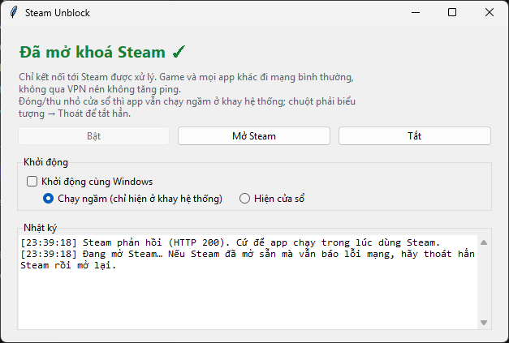
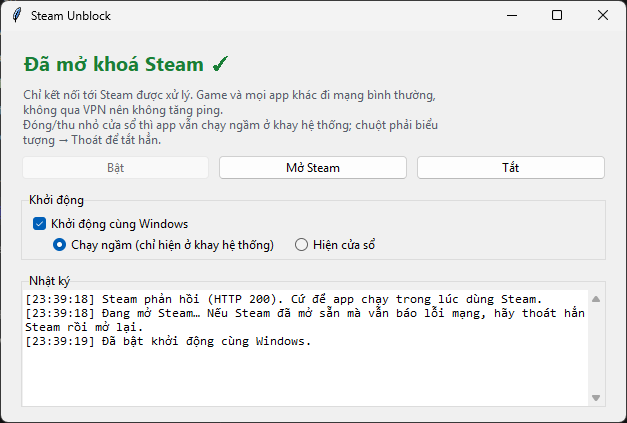
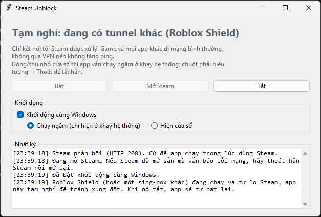
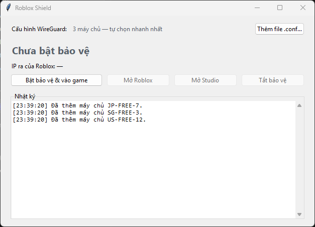
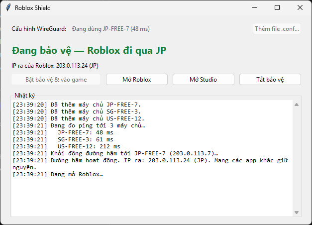

# 🛡️ RobloxVPNShield

Bộ công cụ mạng cho game thủ Việt Nam trên Windows 10/11 (64-bit):

| App | Dùng để làm gì | Cần VPN? |
|---|---|---|
| 🎮 **Steam Unblock** | Vào được Steam khi nhà mạng chặn, ping game không đổi | Không |
| 🛡️ **Roblox Shield** | Chỉ cho Roblox đi qua VPN (Proton VPN miễn phí), app khác giữ mạng nhà | Có (WireGuard) |
| 🚨 **Roblox Guard** | Chạy ngầm, chặn Roblox khi bạn quên bật Roblox Shield | Đi kèm Roblox Shield |

**Tải về:** [Steam Unblock](https://github.com/Edvat07/RobloxVPNShield/releases/tag/v1.0.0) · [Roblox Shield + Roblox Guard](https://github.com/Edvat07/RobloxVPNShield/releases/tag/roblox-shield-v1.0.0)

---

## 🎮 Steam Unblock

Nhà mạng chặn Steam theo **2 lớp**: DNS bị giả mạo (đổi sang 8.8.8.8 cũng không ăn thua) và thiết bị lọc (DPI) ngắt kết nối khi đọc thấy tên miền Steam. Steam Unblock vượt cả hai **mà không dùng VPN**, nên ping khi chơi game không đổi.

### Hướng dẫn từng bước

**Bước 1. Tải và giải nén**
1. Vào [trang tải Steam Unblock](https://github.com/Edvat07/RobloxVPNShield/releases/tag/v1.0.0), bấm vào `SteamUnblock-v1.0.0-win64.zip` để tải.
2. Chuột phải file zip → **Extract All…** → chọn một thư mục cố định, ví dụ `C:\Apps\SteamUnblock`.
3. Giữ nguyên thư mục `core` nằm cạnh `SteamUnblock.exe` (bên trong có `sing-box.exe` và `wintun.dll`).

**Bước 2. Chạy app**
1. Mở `SteamUnblock.exe`.
2. Windows hỏi quyền Administrator → bấm **Yes**. App cần quyền này để tạo card mạng ảo.
3. Đợi vài giây đến khi hiện dòng chữ xanh **"Đã mở khoá Steam ✓"**.

**Bước 3. Vào Steam**
- Bấm **Mở Steam**.
- Nếu Steam đã mở sẵn từ trước mà vẫn báo lỗi mạng: chuột phải icon Steam ở khay → **Exit**, rồi mở lại Steam.

**Bước 4 (tuỳ chọn). Chạy ngầm và khởi động cùng Windows**
- Bấm **X** hoặc thu nhỏ: app ẩn xuống khay hệ thống (góc phải thanh Taskbar, có thể nằm trong mũi tên `^`), Steam vẫn được mở khoá.
- Bấm icon ở khay để mở lại cửa sổ. Chuột phải icon → **Thoát** để tắt hẳn.
- Tick **Khởi động cùng Windows**, rồi chọn:
  - **Chạy ngầm (chỉ hiện ở khay hệ thống)**: mở máy là Steam được mở khoá luôn, không hiện cửa sổ.
  - **Hiện cửa sổ**: mở máy thì cửa sổ app hiện lên.

> Khởi động cùng Windows dùng Task Scheduler với quyền cao nhất, nên lúc đăng nhập **không** hiện hộp thoại UAC. Nếu sau này bạn chuyển thư mục app đi chỗ khác, hãy mở app một lần ở chỗ mới để nó tự cập nhật.

### Cách hoạt động
- Tên miền Steam được phân giải qua **DNS mã hoá** (DNS-over-HTTPS tới 1.1.1.1), nên nhà mạng không giả mạo được.
- Tên miền Steam nhận một **IP ảo**. Chỉ dải IP ảo đó đi vào card mạng ảo. Ở đó gói TLS đầu tiên (ClientHello) được **chia thành nhiều TLS record** để DPI không đọc được tên miền, rồi kết nối **đi thẳng** ra mạng nhà, không qua máy chủ trung gian nào.
- Game, voice chat và mọi app khác **không đi qua** app → ping không đổi.

### Dùng cùng Roblox Shield
Roblox Shield cũng tự mở khoá Steam theo cách tương tự. Khi Roblox Shield bật bảo vệ, Steam Unblock tự **tạm nghỉ** để hai app không tranh nhau mạng, và **tự bật lại** khi Roblox Shield tắt. Bạn không phải làm gì.

---

## 🛡️ Roblox Shield

Chỉ cho **Roblox** (game, Studio và trang web roblox.com) đi qua đường hầm WireGuard của Proton VPN. Mọi app khác vẫn dùng mạng Việt Nam bình thường.

- **Không rò IP:** Roblox không có đường dự phòng. VPN rớt thì Roblox mất mạng chứ không lộ IP Việt Nam.
- **Kill switch:** khi chưa bật bảo vệ, mọi tiến trình Roblox bị đóng ngay. Tắt hay crash app thì Roblox và đường hầm cũng tắt theo.
- **Tự chọn máy chủ nhanh nhất:** có nhiều file cấu hình (JP, SG, US…) thì app đo ping và dùng máy chủ ping thấp nhất.
- **Kiểm tra IP ra** lúc kết nối và mỗi phút một lần.
- Không cần mở app Proton VPN.

### Hướng dẫn từng bước

**Bước 1. Lấy file cấu hình WireGuard từ Proton VPN (miễn phí)**
1. Đăng ký/đăng nhập tại [account.protonvpn.com](https://account.protonvpn.com) (gói Free là đủ).
2. Vào mục **Downloads** → kéo xuống **WireGuard configuration**.
3. Đặt tên thiết bị bất kỳ, chọn Platform **Windows**, chọn một máy chủ (gói Free có một số nước như Nhật, Hà Lan, Mỹ…) rồi bấm **Create** để tải file `.conf`.
4. Muốn app tự chọn máy chủ nhanh nhất thì tải thêm vài file cho các nước khác nhau.
5. Để các file `.conf` trong thư mục **Downloads** (hoặc thư mục con như `Downloads\VPN`). App tự tìm thấy, không cần chọn tay.

> ⚠️ File `.conf` chứa **khoá riêng** của bạn. Không gửi cho ai, không đưa lên mạng. File hết hạn sau **1 năm**: app báo trước 30 ngày, khi đó tải file mới bỏ vào Downloads là xong.

**Bước 2. Tải và giải nén**
1. Vào [trang tải Roblox Shield](https://github.com/Edvat07/RobloxVPNShield/releases/tag/roblox-shield-v1.0.0), tải `RobloxShield-v1.0.0-win64.zip`.
2. Giải nén ra một thư mục cố định, ví dụ `C:\Apps\RobloxShield`. Giữ nguyên thư mục `core` cạnh các file exe.

**Bước 3. Mở Roblox Shield**
1. Mở `RobloxShield.exe`, bấm **Yes** ở hộp thoại Administrator.
2. Dòng *Cấu hình WireGuard* hiện số máy chủ app đã tìm thấy. Nếu hiện *(chưa có)*, bấm **Thêm file .conf…** và chọn file đã tải ở Bước 1.

**Bước 4. Bật bảo vệ và chơi**
1. Bấm **Bật bảo vệ & vào game**. App đo ping, kết nối máy chủ nhanh nhất, kiểm tra IP ra rồi tự mở Roblox.
2. Khi dòng chữ xanh **"Đang bảo vệ — Roblox đi qua …"** hiện lên là xong. Dùng **Mở Roblox** / **Mở Studio** để mở lại game bất cứ lúc nào.
3. Chơi xong bấm **Tắt bảo vệ** (Roblox sẽ bị đóng theo).

> Đừng bấm Connect trong app Proton VPN cùng lúc: hai VPN sẽ tranh nhau. Roblox Shield sẽ báo nếu phát hiện VPN khác đang bật.

---

## 🚨 Roblox Guard (chống quên bật Roblox Shield)

`RobloxGuard.exe` nằm cùng thư mục với Roblox Shield. Chạy **một lần** là nó tự đăng ký **khởi động cùng Windows** và chạy ngầm ở khay hệ thống:

- Mở Roblox / Roblox Studio khi Shield **chưa bảo vệ** → game bị đóng ngay, Roblox Shield tự mở và bật bảo vệ. Xong thì bấm Play lại.
- Trang web Roblox bị **chặn** (qua file `hosts` của Windows) khi Shield chưa bảo vệ, nên trình duyệt không bao giờ vào Roblox bằng IP Việt Nam. Mở trang bị chặn → Shield cũng tự bật; xong thì tải lại trang (F5).
- Chuột phải icon ở khay:
  - **Tạm tắt canh gác**: bỏ chặn web đến lần mở máy sau.
  - **Gỡ khỏi khởi động cùng Windows**: tắt hẳn và không tự chạy nữa.

> Một số phần mềm diệt virus có thể cảnh báo vì Roblox Guard sửa file `hosts`. App chỉ thêm/gỡ đúng một khối có đánh dấu `# >>> Roblox Guard`, không đụng các dòng khác.

---

## ❓ Câu hỏi thường gặp

**Phần mềm diệt virus báo có virus?**
Các file exe được đóng gói bằng PyInstaller và xin quyền Administrator, nên đôi khi bị báo nhầm. Toàn bộ mã nguồn nằm trong repo này; bạn có thể tự build (xem bên dưới).

**Steam Unblock bật rồi mà Steam vẫn lỗi?**
Thoát hẳn Steam (chuột phải icon ở khay → Exit) rồi mở lại. Nếu vẫn lỗi, bấm **Tắt** rồi **Bật** trong Steam Unblock và xem phần Nhật ký.

**Gỡ app thế nào?**
Bỏ tick *Khởi động cùng Windows* (Steam Unblock) hoặc chọn *Gỡ khỏi khởi động cùng Windows* (Roblox Guard), thoát app, rồi xoá thư mục app.

---

## 🔧 Build từ mã nguồn

Cần Python 3.12. Đặt `sing-box.exe` và `wintun.dll` vào thư mục `core\`, rồi chạy `v2\build.bat`. Kết quả (`RobloxShield.exe`, `SteamUnblock.exe`, `RobloxGuard.exe`) nằm ở `v2\release\`.

## Giấy phép thành phần bên thứ ba
- [sing-box](https://github.com/SagerNet/sing-box) v1.14.3: GPL-3.0-or-later. Được chạy như một chương trình riêng, dự án này không liên kết với sing-box.
- [Wintun](https://www.wintun.net/): bản DLL đã ký, phân phối nguyên gốc.
- Steam là thương hiệu của Valve Corporation, Roblox là thương hiệu của Roblox Corporation. Dự án này không liên kết với hai công ty đó.
