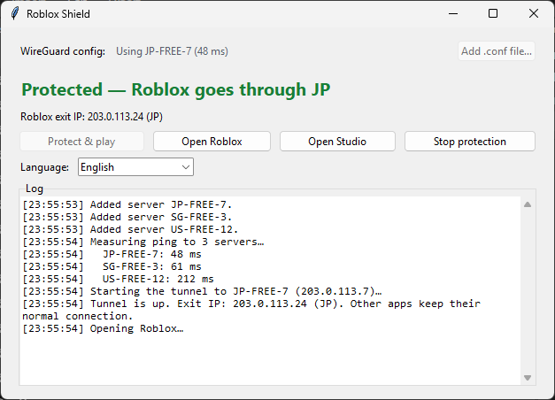
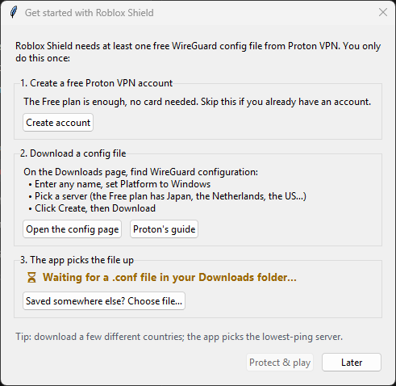
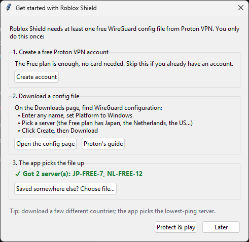
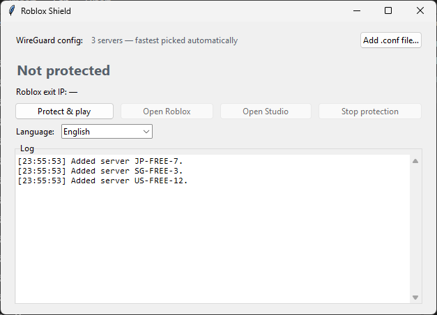
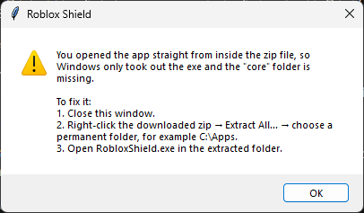

# 🛡️ Roblox Shield

**English** · [Tiếng Việt](README.vi.md)

Send **only Roblox** (game, Studio and the roblox.com website) through a WireGuard tunnel from Proton VPN's free plan. Every other app keeps your normal connection.

| App | What it does |
|---|---|
| 🛡️ **Roblox Shield** | Runs the tunnel for Roblox only, picks the fastest server, never lets Roblox fall back to your real IP |
| 🚨 **Roblox Guard** | Runs in the background and blocks Roblox whenever you forgot to turn Roblox Shield on |

Windows 10/11 (64-bit) · UI in English and Vietnamese

**Download:** [latest release](https://github.com/Edvat07/RobloxVPNShield/releases/latest)

> Looking for **Steam Unblock**? It now has its own repo: **[Edvat07/SteamUnblock](https://github.com/Edvat07/SteamUnblock)**.

---

## 🛡️ Roblox Shield

- **No IP leaks:** Roblox has no fallback route. If the VPN drops, Roblox goes offline instead of exposing your real IP.
- **Kill switch:** while protection is off, every Roblox process is closed at once. Quitting or crashing the app also stops Roblox and the tunnel.
- **Fastest server automatically:** with several configs (JP, SG, US…), the app pings them all and uses the lowest ping.
- **Exit IP check** when connecting and every minute after.
- Unblocks Steam too while it runs (see [Steam Unblock](https://github.com/Edvat07/SteamUnblock)).
- No need to open the Proton VPN app.

### Step-by-step guide

> **New here? The app walks you through it.** On the first start, if no config is found, a **Get started** window opens with buttons that take you straight to Proton's sign-up and config pages. Download the config and the app **picks it up from Downloads by itself** — no need to choose the file.
>
> 

**Step 1. Get a WireGuard config from Proton VPN (free)**
1. Sign up / sign in at [account.protonvpn.com](https://account.protonvpn.com) (the Free plan is enough).
2. Go to **Downloads** → scroll to **WireGuard configuration**.
3. Enter any device name, choose Platform **Windows**, pick a server (the Free plan offers a few countries such as Japan, the Netherlands, the US…) and click **Create** to download the `.conf` file.
4. To let the app pick the fastest server, download a few configs for different countries.
5. Leave the `.conf` files in your **Downloads** folder (or a subfolder such as `Downloads\VPN`). The app finds them on its own.

> ⚠️ A `.conf` file contains your **private key**. Never share it or upload it anywhere. It expires after **1 year**: the app warns you 30 days ahead; then download a new one into Downloads.

**Step 2. Download and extract**
1. Open the [latest release](https://github.com/Edvat07/RobloxVPNShield/releases/latest) and download `RobloxShield-v*-win64.zip`.
2. Extract it to a permanent folder, for example `C:\Apps\RobloxShield`. Keep the `core` folder next to the exe files.

**Step 3. Open Roblox Shield**
1. Open `RobloxShield.exe` and click **Yes** at the Administrator prompt.
2. The *WireGuard config* line shows how many servers were found. With no config yet, the **Get started** window opens (you can reopen it with **Setup guide…**): it waits for the file and shows **✓ Got … server(s)** as soon as your download finishes. Saved the file somewhere else? Use **Saved somewhere else? Choose file…** or **Add .conf file…**.

**Step 4. Protect and play**
1. Click **Protect & play**. The app pings the servers, connects to the fastest one, checks the exit IP and opens Roblox.
2. Done when the green **"Protected — Roblox goes through …"** appears. Use **Open Roblox** / **Open Studio** to reopen the game any time.
3. When you finish, click **Stop protection** (Roblox is closed with it).

> Do not press Connect in the Proton VPN app at the same time: two VPNs fight each other. Roblox Shield tells you if it detects another VPN.

**Language:** the app follows your Windows display language; change it with the **Language** box in the window (the app offers to restart). Roblox Guard uses the same choice.

---

## 🚨 Roblox Guard (never forget to turn Roblox Shield on)

`RobloxGuard.exe` sits in the same folder as Roblox Shield. Run it **once**: it registers itself to **start with Windows** and runs in the system tray.

- Open Roblox / Roblox Studio while Shield is **not protecting** → the game is closed right away, and Roblox Shield opens and turns protection on. Then press Play again.
- The Roblox **website is blocked** (through the Windows `hosts` file) while Shield is not protecting, so your browser never reaches Roblox with your real IP. Opening the blocked page also starts Shield; then reload (F5).
- Right-click the tray icon:
  - **Pause guarding**: unblocks the website until the next restart.
  - **Remove from Windows startup**: quits and stops starting automatically.

> Some antivirus apps may warn because Roblox Guard edits the `hosts` file. It only adds/removes one block marked `# >>> Roblox Guard` and never touches other lines.

---

## FAQ

**"You opened the app straight from inside the zip file".**
You double-clicked the exe inside the zip without extracting it, so the `core` folder is missing. Right-click the zip → **Extract All…**, then open the exe from the extracted folder.

**My antivirus flags the exe.**
The exe files are packaged with PyInstaller and ask for Administrator rights, which sometimes causes false positives. All source code is in this repo; you can build it yourself (below).

**How do I uninstall it?**
In Roblox Guard choose *Remove from Windows startup*, close Roblox Shield, then delete the app folder.

---

## Build from source

Requires Python 3.12. Put `sing-box.exe` and `wintun.dll` into `core\`, then run `v2\build.bat`. The results (`RobloxShield.exe`, `RobloxGuard.exe`) are in `v2\release\`.

## Third-party components
- [sing-box](https://github.com/SagerNet/sing-box) v1.14.3: GPL-3.0-or-later. Run as a separate program; this project is not affiliated with sing-box.
- [Wintun](https://www.wintun.net/): prebuilt signed DLL, distributed unmodified.
- Roblox is a trademark of Roblox Corporation; Proton VPN is a trademark of Proton AG. This project is not affiliated with either.
