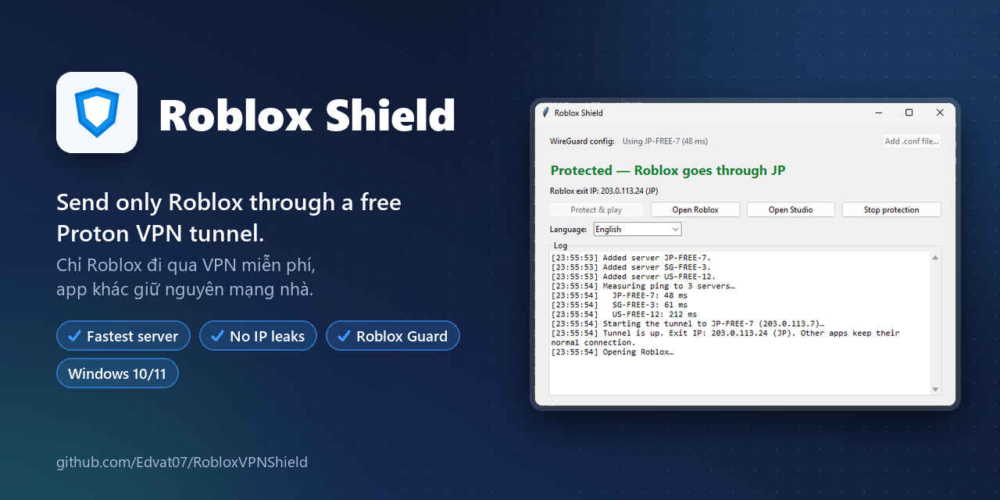
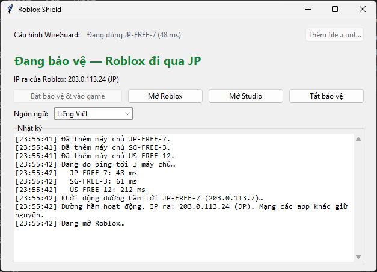
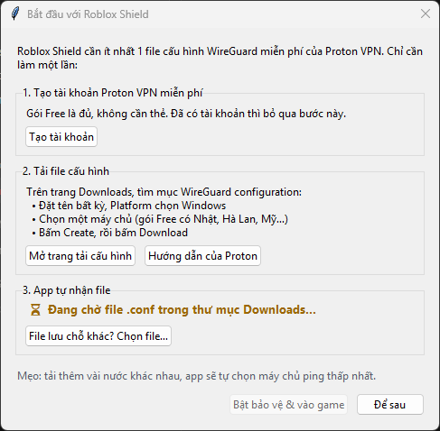
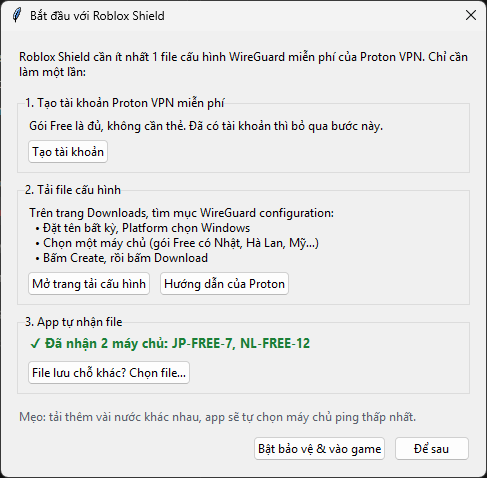
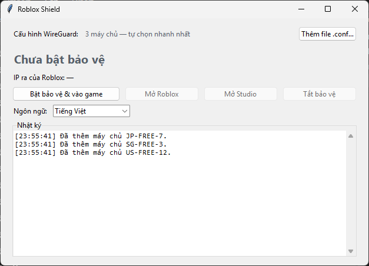
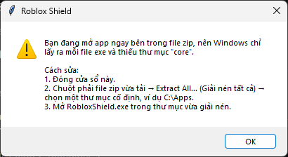

  

  
  
  
  

<a href="README.md">English</a> · <b>Tiếng Việt</b>

Chỉ cho **Roblox** (game, Studio và trang web roblox.com) đi qua đường hầm WireGuard của Proton VPN (gói miễn phí là đủ). Mọi app khác vẫn dùng mạng Việt Nam bình thường.

| App | Dùng để làm gì |
|---|---|
| 🛡️ **Roblox Shield** | Chạy đường hầm chỉ cho Roblox, tự chọn máy chủ nhanh nhất, không bao giờ để Roblox lộ IP Việt Nam |
| 🚨 **Roblox Guard** | Chạy ngầm, chặn Roblox khi bạn quên bật Roblox Shield |

Windows 10/11 (64-bit) · Giao diện tiếng Việt và tiếng Anh

**Tải về:** [bản mới nhất](https://github.com/Edvat07/RobloxVPNShield/releases/latest)

> Tìm **Steam Unblock**? App này đã chuyển sang repo riêng: **[Edvat07/SteamUnblock](https://github.com/Edvat07/SteamUnblock)**.

---

## 🛡️ Roblox Shield

- **Không rò IP:** Roblox không có đường dự phòng. VPN rớt thì Roblox mất mạng chứ không lộ IP Việt Nam.
- **Kill switch:** khi chưa bật bảo vệ, mọi tiến trình Roblox bị đóng ngay. Tắt hay crash app thì Roblox và đường hầm cũng tắt theo.
- **Tự chọn máy chủ nhanh nhất:** có nhiều file cấu hình (JP, SG, US…) thì app đo ping và dùng máy chủ ping thấp nhất.
- **Kiểm tra IP ra** lúc kết nối và mỗi phút một lần.
- Trong lúc chạy cũng tự mở khoá Steam (xem [Steam Unblock](https://github.com/Edvat07/SteamUnblock)).
- Không cần mở app Proton VPN.

### Hướng dẫn từng bước

> **Người mới? App sẽ hướng dẫn từng bước.** Lần đầu mở app mà chưa có cấu hình, cửa sổ **Bắt đầu** sẽ hiện ra, có nút mở thẳng trang đăng ký và trang tải cấu hình của Proton. Tải file xong là app **tự nhận file trong thư mục Downloads**, không cần chọn file.
>
> 

**Bước 1. Lấy file cấu hình WireGuard từ Proton VPN (miễn phí)**
1. Đăng ký/đăng nhập tại [account.protonvpn.com](https://account.protonvpn.com) (gói Free là đủ).
2. Vào mục **Downloads** → kéo xuống **WireGuard configuration**.
3. Đặt tên thiết bị bất kỳ, chọn Platform **Windows**, chọn một máy chủ (gói Free có một số nước như Nhật, Hà Lan, Mỹ…) rồi bấm **Create** để tải file `.conf`.
4. Muốn app tự chọn máy chủ nhanh nhất thì tải thêm vài file cho các nước khác nhau.
5. Để các file `.conf` trong thư mục **Downloads** (hoặc thư mục con như `Downloads\VPN`). App tự tìm thấy, không cần chọn tay.

> ⚠️ File `.conf` chứa **khoá riêng** của bạn. Không gửi cho ai, không đưa lên mạng. File hết hạn sau **1 năm**: app báo trước 30 ngày, khi đó tải file mới bỏ vào Downloads là xong.

**Bước 2. Tải và giải nén**
1. Vào [bản mới nhất](https://github.com/Edvat07/RobloxVPNShield/releases/latest), tải `RobloxShield-v*-win64.zip`.
2. Giải nén ra một thư mục cố định, ví dụ `C:\Apps\RobloxShield`. Giữ nguyên thư mục `core` cạnh các file exe.

**Bước 3. Mở Roblox Shield**
1. Mở `RobloxShield.exe`, bấm **Yes** ở hộp thoại Administrator.
2. Dòng *Cấu hình WireGuard* hiện số máy chủ app đã tìm thấy. Chưa có cấu hình thì cửa sổ **Bắt đầu** sẽ mở (mở lại bằng nút **Hướng dẫn…**): nó chờ file và hiện **✓ Đã nhận … máy chủ** ngay khi bạn tải xong. File lưu chỗ khác? Bấm **File lưu chỗ khác? Chọn file…** hoặc **Thêm file .conf…**.

**Bước 4. Bật bảo vệ và chơi**
1. Bấm **Bật bảo vệ & vào game**. App đo ping, kết nối máy chủ nhanh nhất, kiểm tra IP ra rồi tự mở Roblox.
2. Khi dòng chữ xanh **"Đang bảo vệ — Roblox đi qua …"** hiện lên là xong. Dùng **Mở Roblox** / **Mở Studio** để mở lại game bất cứ lúc nào.
3. Chơi xong bấm **Tắt bảo vệ** (Roblox sẽ bị đóng theo).

> Đừng bấm Connect trong app Proton VPN cùng lúc: hai VPN sẽ tranh nhau. Roblox Shield sẽ báo nếu phát hiện VPN khác đang bật.

**Ngôn ngữ:** app tự theo ngôn ngữ hiển thị của Windows; đổi bằng ô **Ngôn ngữ** trong cửa sổ (app sẽ hỏi mở lại). Roblox Guard dùng chung lựa chọn này.

---

## 🚨 Roblox Guard (chống quên bật Roblox Shield)

`RobloxGuard.exe` nằm cùng thư mục với Roblox Shield. Chạy **một lần** là nó tự đăng ký **khởi động cùng Windows** và chạy ngầm ở khay hệ thống:

- Mở Roblox / Roblox Studio khi Shield **chưa bảo vệ** → game bị đóng ngay, Roblox Shield tự mở và bật bảo vệ. Xong thì bấm Play lại.
- Trang web Roblox bị **chặn** (qua file `hosts` của Windows) khi Shield chưa bảo vệ, nên trình duyệt không bao giờ vào Roblox bằng IP Việt Nam. Mở trang bị chặn → Shield cũng tự bật; xong thì tải lại trang (F5).
- Chuột phải icon ở khay:
  - **Tạm tắt canh gác**: bỏ chặn web đến lần mở máy sau.
  - **Gỡ khỏi khởi động cùng Windows**: tắt hẳn và không tự chạy nữa.

> Một số phần mềm diệt virus có thể cảnh báo vì Roblox Guard sửa file `hosts`. App chỉ thêm/gỡ đúng một khối có đánh dấu `# >>> Roblox Guard`, không đụng các dòng khác.

---

## Câu hỏi thường gặp

**App báo "Bạn đang mở app ngay bên trong file zip"?**
Bạn bấm đúp file exe ngay trong file zip mà chưa giải nén, nên thiếu thư mục `core`. Chuột phải file zip → **Extract All…**, rồi mở exe trong thư mục vừa giải nén.

**Phần mềm diệt virus báo có virus?**
Các file exe được đóng gói bằng PyInstaller và xin quyền Administrator, nên đôi khi bị báo nhầm. Toàn bộ mã nguồn nằm trong repo này; bạn có thể tự build (xem bên dưới).

**Gỡ app thế nào?**
Trong Roblox Guard chọn *Gỡ khỏi khởi động cùng Windows*, đóng Roblox Shield, rồi xoá thư mục app.

---

## Build từ mã nguồn

Cần Python 3.12. Đặt `sing-box.exe` và `wintun.dll` vào thư mục `core\`, rồi chạy `v2\build.bat`. Kết quả (`RobloxShield.exe`, `RobloxGuard.exe`) nằm ở `v2\release\`.

## Thành phần bên thứ ba
- [sing-box](https://github.com/SagerNet/sing-box) v1.14.3: GPL-3.0-or-later. Được chạy như một chương trình riêng, dự án này không liên kết với sing-box.
- [Wintun](https://www.wintun.net/): bản DLL đã ký, phân phối nguyên gốc.
- Roblox là thương hiệu của Roblox Corporation, Proton VPN là thương hiệu của Proton AG. Dự án này không liên kết với hai công ty đó.
